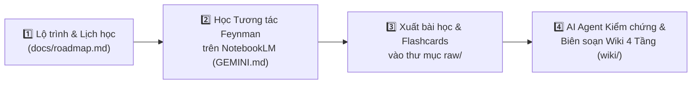

# 🧠 Universal Obsidian + NotebookLM Learning Starter-Kit

> **Hệ thống Quản trị Tri thức & Học tập Chủ động Đa Lĩnh Vực (Kinh tế, Y Dược, Luật, Thiết kế, Ngoại ngữ, Kỹ thuật/IT...)**
> Kết hợp sức mạnh giảng dạy tương tác theo phương pháp Feynman của **Google NotebookLM** với khả năng kiểm chứng, bồi đắp và biên soạn Kho Tri thức 4 Tầng tự động của **AI Agent (Claude Code / Cursor / Antigravity / Codex...)** trên **Obsidian**.

---

## 🌟 Vì sao Hệ thống này Hiệu quả cho Mọi Ngành?

Khi tự học một lĩnh vực mới từ sách giáo trình, PDF hay tài liệu dài, chúng ta thường gặp 3 nỗi đau lớn:
1. **Ngợp kiến thức (Overwhelmed):** Đọc tài liệu thấy cái gì cũng quan trọng, sa lầy vào chi tiết quá khó ngay từ đầu dẫn đến bỏ cuộc.
2. **Học vẹt / Quên nhanh:** Đọc xong tưởng đã hiểu nhưng không giải thích lại được bằng lời của mình và không biết áp dụng vào tình huống thực tế ra sao.
3. **Ghi chú rời rạc (Graveyard of Notes):** Ghi chép xong bỏ xó, không có hệ thống mục lục hay liên kết chéo để tra cứu lại khi cần.

**Starter-Kit này giải quyết triệt để bằng chu trình khép kín 4 bước:**



---

## 🚀 Hướng dẫn Bắt đầu Nhanh trong 3 Phút (Quick Start)

### Bước 1: Mở Vault và Chạy Lệnh `/init` với AI Agent
1. Clone hoặc tải repo này về máy.
2. Mở thư mục này bằng **Obsidian** (để xem giao diện Wiki) VÀ mở bằng công cụ **AI Agent** của bạn (Claude Code, Cursor, Antigravity, Windsurf...).
3. Trong khung chat với AI Agent, gõ lệnh:
   ```text
   /init
   ```
4. **AI Agent sẽ hỏi bạn 4 câu ngắn gọn:**
   - **Câu 1 (Lĩnh vực & Mục tiêu):** Bạn muốn học ngành gì (Tài chính, Y khoa, Luật, Marketing, Ngoại ngữ, Lập trình...)? Mục tiêu cụ thể là gì?
   - **Câu 2 (Trình độ & Thời gian):** Bạn đang ở mức nào và dành được bao nhiêu thời gian mỗi tuần?
   - **Câu 3 (Nguồn tài liệu):** Bạn đã có sẵn sách PDF/giáo trình riêng để nạp vào NotebookLM, hay muốn Agent tự thiết kế lộ trình từ A–Z kèm nguồn chuẩn?
   - **Câu 4 (Cấp độ & Ví dụ thực tế):** Bạn muốn dùng bộ nhãn 3 tầng độ sâu nào phù hợp với ngành của mình (ví dụ: *Cơ chế ➔ Lâm sàng ➔ Chuyên khoa*, hay *Khái niệm ➔ Case Study ➔ Chiến lược*)?
5. Ngay sau khi bạn trả lời, Agent sẽ **tự động cá nhân hóa toàn bộ hệ thống**: cập nhật [`CLAUDE.md`](CLAUDE.md), [`GEMINI.md`](GEMINI.md), thiết kế [`docs/roadmap.md`](docs/roadmap.md), tạo khung [`wiki/00-master-hub.md`](wiki/00-master-hub.md) và lên sẵn **Lịch học Tuần 1 (`docs/lich-hoc-tuan-1.md`)** cho bạn!

---

### Bước 2: Cài đặt "Gia sư" trên Google NotebookLM (Chỉ làm 1 lần)
1. Truy cập [Google NotebookLM](https://notebooklm.google.com/) → mở một notebook bất kỳ → bấm biểu tượng **⚙️ (Configure Chat)** ở góc khung chat.
2. Mở file [`GEMINI.md`](GEMINI.md) (sau khi đã chạy `/init`), copy toàn bộ nội dung **từ dòng `# SYSTEM INSTRUCTION` trở xuống** và dán vào ô **Custom Prompt** → bấm **Save**.

---

### Bước 3: Quy trình Học Hàng ngày (30–45 phút/buổi)

#### 1. Khởi tạo buổi học trên NotebookLM
- Mở file lịch học tuần hiện tại (ví dụ: `docs/lich-hoc-tuan-1.md`) → tìm đến **Ngày học hôm nay**.
- Tạo một Notebook mới trên NotebookLM → nạp các tài liệu trong mục **Nguồn tài liệu** (có thể là file PDF giáo trình, sách, slide bài giảng, link web chính thống hoặc YouTube).
- Copy nguyên khối văn bản trong mục **`### Customize notebook`** của ngày hôm đó → dán vào **⚙️ → Customize notebook** trên NotebookLM (hoặc dán kèm lệnh `/outline` ở tin nhắn đầu tiên).

#### 2. Học tương tác với 5 lệnh chuẩn trên NotebookLM
Gõ lần lượt 5 lệnh ngắn gọn sau vào khung chat NotebookLM:

| Thứ tự | Lệnh | Gia sư NotebookLM sẽ làm gì cho bạn? |
|---|---|---|
| **1** | `/outline` | Quét tài liệu nguồn, lọc ra **4–6 mục cốt lõi nhất** phù hợp với trình độ hiện tại. Các phần quá sâu/hàn lâm sẽ được tách riêng vào **`🎒 Deep-Dive Backlog`** để bạn không bị ngợp. |
| **2** | `/teach` | Giảng từng mục một (`1.1 → 1.2...`) theo 4 bước: **Định nghĩa bình dân ➔ Ẩn dụ đời thường ➔ Quy trình/Cơ chế & Ví dụ thực tế (Case study/Tình huống) ➔ 1 câu hỏi gợi mở nhẹ nhàng**. Khi bạn trả lời đúng, gia sư sẽ hỏi xem bạn còn thắc mắc gì ở mục đó không; khi bạn xác nhận không còn câu hỏi thì mới qua mục tiếp theo! *(Sơ đồ được vẽ dạng dọc tối ưu để bạn đọc thoải mái ngay cả trên điện thoại).* |
| **3** | `/flash-1` | Tạo bộ câu hỏi ôn tập **Flashcards Cấp 1** từ chính những gì bạn vừa học trong `/teach`. |
| **4** | `/flash-2` | Quét tài liệu nguồn tìm **3–5 mảnh ghép thực tế còn sót**, giảng nhanh qua **`📖 Mini-Lesson (1 phút)`** rồi mới tạo **`🃏 Flashcard Q&A Cấp 2`** (cam kết *Giảng trước — Hỏi sau*, không bao giờ hỏi đánh đố những gì chưa dạy). |
| **5** | `/export` | Đóng gói toàn bộ buổi học (hợp nhất lý thuyết `/teach` + `Mini-Lesson` của `/flash-2` + Bộ Flashcards Tổng hợp + Backlog) thành một file Markdown chuẩn chỉnh. |

#### 3. Lưu vào `raw/` và để AI Agent xây dựng Wiki
- Copy kết quả từ lệnh `/export` trên NotebookLM, lưu thành một file `.md` mới trong thư mục `raw/` (ví dụ: `raw/2026-11-18-bai-hoc-1.md`).
- Quay lại khung chat với AI Agent và nhắn:
  > *"Ingest file `raw/2026-11-18-bai-hoc-1.md` vào wiki"*
- **AI Agent sẽ tự động làm hết phần việc nặng nhọc (Chuỗi Đồng bộ 5 Điểm):**
  1. Chuẩn hóa công thức, bảng biểu và chuyển mọi sơ đồ chữ sang biểu đồ **Mermaid** trực quan.
  2. Kiểm chứng độ chính xác với tài liệu gốc/chuẩn ngành và **tự động bồi đắp (Auto-Enrich)** nếu có khái niệm nào bị tóm tắt quá sơ sài.
  3. Chia tách thành các bài viết nguyên tử (`concept-*.md`, `compare-*.md`, `backlog-*.md`, `source-*.md`) trong `wiki/`.
  4. Cập nhật **Bảng Danh mục (`00-index-*.md`)**, **Bản đồ Hub (`00-hub-*.md`)** và liên kết chéo `[[wikilinks]]` 2 chiều với các bài học cũ.
  5. Đánh dấu hoàn thành buổi học trong `docs/lich-hoc-tuan-X.md` và ghi nhật ký vào `wiki/log.md`.

---

## 📂 Cấu trúc Thư mục của Starter-Kit

```text
├── docs/                          ← Quản lý Kế hoạch & Lịch học theo Thời gian
│   ├── roadmap.md                 ← Bản đồ tổng thể (Được tạo tự động khi chạy /init)
│   ├── template-lich-hoc.md       ← Khuôn mẫu thiết kế buổi học theo 2 chế độ độ sâu
│   └── lich-hoc-tuan-1.md         ← Lịch học chi tiết từng buổi + khối Customize notebook
│
├── raw/                           ← Nơi bạn lưu bản xuất nguyên gốc từ lệnh /export của NotebookLM
│
├── wiki/                          ← Kho Tri thức Tích lũy 4 Tầng (Agent tự động biên soạn & liên kết)
│   ├── 00-master-hub.md           ← [Tầng 0] Bản đồ Tổng thể toàn bộ Lĩnh vực
│   ├── log.md                     ← Nhật ký kiểm chứng & cập nhật Wiki
│   └── 00-core-trunk/             ← [Tầng 1] Thư mục Giai đoạn / Chuyên đề lớn
│       ├── 00-hub-core-trunk.md   ← Bản đồ Giai đoạn Nền tảng
│       └── 01-hoc-phan-1/         ← [Tầng 2] Thư mục từng Học phần cụ thể
│           ├── 00-index-*.md      ← Bảng Danh mục (Table List) & Full Lộ trình Học phần
│           ├── concept-*.md       ← [Tầng 3] Bài viết Lý thuyết cốt lõi & Tình huống thực tế
│           ├── compare-*.md       ← [Tầng 3] Bài viết So sánh & Đối chiếu trực diện
│           ├── backlog-*.md       ← [Tầng 3] Kiến thức chuyên sâu để dành cho Chuyên đề sau
│           └── source-*.md        ← [Tầng 3] Hồ sơ kiểm chứng nguồn từ raw/
│
├── GEMINI.md                      ← System Instruction cho NotebookLM (⚙️ → Configure Chat)
├── CLAUDE.md                      ← Hiến pháp & Quy trình tự động cho AI Agent
├── AGENTS.md                      ← Điểm neo điều hướng cho mọi công cụ AI Agent
└── README.md                      ← Hướng dẫn sử dụng (file này)
```

---

## 💡 Các Lệnh Hữu ích với AI Agent

| Lệnh / Yêu cầu | Chức năng |
|---|---|
| `/init` | Phỏng vấn 4 câu để khởi tạo Lĩnh vực mới, tạo Roadmap, Hub và Lịch học Tuần 1. |
| `"Ingest file raw/<tên-file>.md"` | Tự động chạy `/pre-ingest` ➔ kiểm chứng & bồi đắp ➔ `/ingest` vào `wiki/` ➔ `/lint`. |
| `"Tạo lịch học tuần tiếp theo"` | Quét tiến độ hiện tại trong `wiki/` và `docs/roadmap.md` để lên lịch học cho tuần mới. |
| `/lint` | Kiểm tra toàn bộ Wiki để sửa link hỏng, đồng bộ mục lục và tìm cơ hội liên kết chéo. |
| `"Giải thích / So sánh X và Y từ wiki"` | Tra cứu kho tri thức của chính bạn và tổng hợp câu trả lời có trích dẫn `[[wikilink]]`. |
