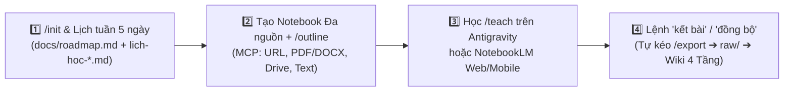

# 🧠 Universal Obsidian + NotebookLM Learning Starter-Kit

> **Hệ thống Quản trị Tri thức & Học tập Chủ động Đa Lĩnh Vực (Kinh tế, Y Dược, Luật, Thiết kế, Ngoại ngữ, Kỹ thuật/IT...)**
> Kết hợp sức mạnh giảng dạy tương tác theo phương pháp Feynman của **Google NotebookLM** với **Workspace Plugin Antigravity + NotebookLM MCP** (tự động tạo notebook đa nguồn, học tương tác, kéo `/export` và biên soạn Kho Tri thức 4 Tầng trên **Obsidian**) — **Agent làm nhiều nhất, bạn gõ ít nhất**.

---

## 🌟 Vì sao Hệ thống này Hiệu quả cho Mọi Ngành?

Khi tự học một lĩnh vực mới từ sách giáo trình, PDF hay tài liệu dài, chúng ta thường gặp 3 nỗi đau lớn:
1. **Ngợp kiến thức (Overwhelmed):** Đọc tài liệu thấy cái gì cũng quan trọng, sa lầy vào chi tiết quá khó ngay từ đầu dẫn đến bỏ cuộc.
2. **Học vẹt / Quên nhanh:** Đọc xong tưởng đã hiểu nhưng không giải thích lại được bằng lời của mình và không biết áp dụng vào tình huống thực tế ra sao.
3. **Thao tác lặp lại & Ghi chú rời rạc:** Tốn công tạo notebook, dán từng link/file, dán prompt, rồi copy-paste hàng chục KB ghi chú về Obsidian nhưng không có mục lục hay liên kết chéo.

**Starter-Kit này tự động hóa trọn vòng đời 4 bước chỉ từ 1 nơi (Antigravity):**



---

## 🚀 Cài đặt trên Máy mới (Windows / macOS / Linux — 2 Phút)

Repo đã đóng gói sẵn **Workspace Plugin** tại [`.agents/plugins/notebooklm-study/`](.agents/plugins/notebooklm-study/) — tự tải đúng phiên bản `notebooklm-mcp-cli >= 0.16.5` qua `uvx`, chỉ kích hoạt riêng cho repo này và lưu cookie an toàn ngoài Git tại `~/.notebooklm-mcp-cli/`:

1. **Clone repo & cài `uv` (nếu máy chưa có):**
   - **Windows (PowerShell):**
     ```powershell
     powershell -ExecutionPolicy ByPass -c "irm https://astral.sh/uv/install.ps1 | iex"
     ```
   - **macOS / Linux:**
     ```bash
     curl -LsSf https://astral.sh/uv/install.sh | sh
     ```
2. **Đăng nhập Google NotebookLM 1 lần duy nhất:**
   ```bash
   uvx --from "notebooklm-mcp-cli>=0.16.5" nlm login
   ```
3. **Mở thư mục này bằng Obsidian** (để đọc Wiki) **và Antigravity**, rồi gõ đúng 1 lệnh:
   ```text
   /init
   ```
   Skill **`study-init`** sẽ tự động:
   - **Chạy Health Check toàn diện** (`uv`/`uvx`, `notebooklm-mcp-cli >= 0.16.5`, `nlm doctor`, ping sống MCP `server_info` + `notebook_list`, kiểm tra ngân sách ký tự `docs/notebooklm-system-prompt.md ≤ 8.350` ký tự).
   - **Phỏng vấn 4 câu ngắn gọn** (Lĩnh vực & Mục tiêu, Trình độ & Quỹ thời gian, Nguồn tài liệu có sẵn hay nhờ gợi ý, Tên 3 tầng độ sâu & Dạng ví dụ thực tế).
   - **Tự thiết lập toàn bộ vault:** cập nhật [`CLAUDE.md`](CLAUDE.md), cá nhân hóa [`docs/notebooklm-system-prompt.md`](docs/notebooklm-system-prompt.md), dựng [`docs/roadmap.md`](docs/roadmap.md), khởi tạo [`wiki/00-master-hub.md`](wiki/00-master-hub.md) và tạo sẵn **Lịch học Tuần 1 (5 ngày)**.

---

## ⚡ Quy trình Học Hàng ngày (Gõ Tối thiểu — Đa Nguồn)

### Bước 1: Tạo Lịch học Tuần mới (5 ngày/tuần)
Khi bước sang tuần mới, nhắn trong Antigravity:
> *"Tạo lịch học tuần 2 từ roadmap"*

Skill **`weekly-study-plan`** tự đọc `docs/roadmap.md`, quét bảng `backlog-*` trong `wiki/`, soạn đủ 5 ngày (mỗi khối `Lesson Scope ≤ 1.400` ký tự) và xác minh toàn bộ nguồn (URL `200 OK`, file nội bộ trong `sources/`, Google Drive, Text).

> **Mẹo dùng tài liệu cá nhân (PDF, DOCX, PPTX, EPUB, Audio, Ảnh):** Chỉ cần thả file vào thư mục `sources/` (đã được `.gitignore` để không đẩy file nặng lên Git) rồi trỏ đường dẫn trong lịch học (ví dụ `[Chương 1](sources/giao-trinh.pdf)`).

### Bước 2: Khởi tạo Buổi học theo Ngày (1 câu lệnh)
Nhắn cực ngắn:
> *"Tạo bài W1D1"*

Skill **`study-day-init`** tự làm 100% không cần mở trình duyệt:
1. Kiểm tra mọi nguồn hợp lệ (`url`/YouTube, `file` trong `sources/`, `drive`, `text`).
2. Tạo notebook mới trên NotebookLM → nạp trọn bộ nguồn và chờ lập chỉ mục xong.
3. Tự ghép [`docs/notebooklm-system-prompt.md`](docs/notebooklm-system-prompt.md) (`≤ 8.350` ký tự) + khối `Lesson Scope` ngày học (`≤ 1.400` ký tự) vào **Configure Chat** (`chat_configure`, tổng `≤ 9.800` ký tự).
4. **Chạy sẵn `/outline` ngay lập tức**, lưu trạng thái active notebook, và in nguyên văn dàn bài + link NotebookLM.

### Bước 3: Học Tương tác (Linh hoạt Antigravity hoặc NotebookLM Web/Mobile)
- **Học ngay trên Antigravity (tự đồng bộ lên lịch sử NotebookLM):**
  Gõ `/teach` → trả lời câu hỏi kiểm tra → nhắn `tiếp` qua từng mục. Khi học xong mục cuối, gõ đúng 1 lệnh **`kết bài`** — Agent tự chạy nối tiếp `/flash-1` → `/flash-2` → `/export` rồi nhảy thẳng sang Bước 4!
- **Hoặc mở link NotebookLM trên Web/Mobile để học:**
  Dàn bài `/outline` đã sẵn sàng trong notebook; bạn gõ `/teach` → `/flash-1` → `/flash-2` → `/export` như bình thường.

| Thứ tự | Lệnh | Gia sư NotebookLM thực hiện |
|---|---|---|
| **1** | `/outline` | *(Tự chạy khi tạo bài)* Lọc **4–6 mục cốt lõi** bám sát `✅ CHECKLIST HÔM NAY`, tách phần vượt trần vào `🎒 Deep-Dive Backlog`. |
| **2** | `/teach` | Giảng từng mục theo 4 bước Feynman (**Định nghĩa ➔ Ẩn dụ ➔ Cơ chế & Ví dụ thực tế ➔ 1 câu hỏi gợi mở**); luôn hỏi còn thắc mắc không trước khi qua mục kế tiếp. |
| **3** | `/flash-1` | Tạo bộ **Flashcards Cấp 1** từ nội dung vừa học trong `/teach`. |
| **4** | `/flash-2` | Bổ sung 3–5 mảnh ghép còn sót từ nguồn theo cặp **`📖 Mini-Lesson`** trước ➔ **`🃏 Flashcard Q&A`** sau. |
| **5** | `/export` | Đóng gói bài học hoàn chỉnh (YAML frontmatter + thân bài chuẩn Mermaid/Bảng Markdown + Bộ Flashcards Tổng hợp + Backlog). |

### Bước 4: Đồng bộ về `raw/` & Xây dựng Wiki 4 Tầng (1 câu lệnh)
- Nếu học trên Antigravity và đã nhắn **`kết bài`**, Bước 4 chạy tự động luôn.
- Nếu học trên NotebookLM Web/Mobile, chỉ cần nhắn trong Antigravity:
  > *"Đồng bộ W1D1"*

Skill **`study-session-and-sync`** tự kéo bản `/export` qua MCP `chat_get` (hoặc tự gửi `/export` nếu chưa có), lưu vào `raw/`, và thực thi liền mạch **Chuỗi Đồng bộ 5 Điểm** theo [`CLAUDE.md`](CLAUDE.md): `/pre-ingest` (chuẩn hóa Mermaid/LaTeX, kiểm chứng, Auto-Enrich 4 bước) → `/ingest` (đồng bộ 2 chiều `raw/` + Flashcards + `wiki/` + `00-index`/`00-hub` + đánh dấu `✅` lịch học & `wiki/log.md`) → `/lint`.

---

<details>
<summary><strong>🛠️ Chế độ Không dùng MCP (Thủ công cho người không dùng Terminal) & Hướng dẫn cho Claude Code / Cursor</strong></summary>

### 1. Chế độ Thủ công (Không cài `uv` / MCP)
Nếu bạn học các ngành không chuyên IT và chưa muốn cài MCP:
1. Mở [Google NotebookLM](https://notebooklm.google.com/) → tạo notebook mới → nạp các tài liệu nguồn (PDF/Link/YouTube/Drive).
2. Mở **⚙️ → Configure Chat → Custom Prompt**: copy toàn bộ phần từ `# SYSTEM INSTRUCTION` trong [`docs/notebooklm-system-prompt.md`](docs/notebooklm-system-prompt.md) **và dán nối tiếp ngay bên dưới** khối `Lesson Scope` của ngày học (tổng `≤ 9.800` ký tự) → bấm **Save**.
3. Gõ `/outline` → `/teach` → `/flash-1` → `/flash-2` → `/export`, lưu kết quả `/export` vào `raw/<ten-file>.md`, rồi nhắn AI Agent: `"Ingest file raw/<ten-file>.md vào wiki"`.

### 2. Nối MCP cho Claude Code / Cursor / OpenCode
Nếu bạn dùng AI Agent khác ngoài Antigravity, chỉ cần thêm khối MCP server sau vào cấu hình MCP của công cụ đó (vẫn dùng chung `CLAUDE.md` và `.agents/plugins/notebooklm-study/scripts/study_helper.py`):
```json
{
  "mcpServers": {
    "notebooklm": {
      "command": "uvx",
      "args": ["--from", "notebooklm-mcp-cli>=0.16.5", "notebooklm-mcp"],
      "env": {
        "NOTEBOOKLM_QUERY_TIMEOUT": "180",
        "NOTEBOOKLM_DISABLED_GROUPS": "studio,sharing,research,organization,automation,query_multi,usage"
      }
    }
  }
}
```

</details>

---

## 📂 Cấu trúc Thư mục của Starter-Kit

```text
├── .agents/plugins/notebooklm-study/  ← Workspace Plugin Antigravity (MCP đa nền tảng + 4 Skills)
│   ├── plugin.json
│   ├── mcp_config.json                ← Tự chạy uvx --from notebooklm-mcp-cli>=0.16.5 notebooklm-mcp
│   ├── rules/AGENTS.md                ← Luật điều hướng /init, đa nguồn & active notebook
│   ├── scripts/study_helper.py        ← Helper Python stdlib (health check, parser 4 loại nguồn, đếm ký tự)
│   └── skills/
│       ├── study-init/                ← Skill 0: Health Check MCP/NotebookLM & /init 4 câu
│       ├── weekly-study-plan/         ← Skill 1: Tạo lịch học tuần (5 ngày)
│       ├── study-day-init/            ← Skill 2: Tạo notebook đa nguồn + Configure Chat + chạy /outline
│       └── study-session-and-sync/    ← Skill 3: Học /teach qua MCP, lệnh "kết bài" & "đồng bộ"
│
├── sources/                           ← Nơi thả sách PDF/DOCX/PPTX/Audio cá nhân (gitignored, giữ .gitkeep)
│
├── docs/                              ← Quản lý Kế hoạch, System Prompt & Lịch học theo Thời gian
│   ├── roadmap.md                     ← Bản đồ tổng thể (Được tạo tự động khi chạy /init)
│   ├── notebooklm-system-prompt.md    ← System Prompt mẫu cho NotebookLM (≤ 8.350 ký tự)
│   ├── template-lich-hoc.md           ← Khuôn mẫu thiết kế buổi học đa nguồn & Lesson Scope
│   └── lich-hoc-tuan-1.md             ← Lịch học chi tiết 5 ngày (tạo tự động sau /init)
│
├── raw/                               ← Bản gốc xuất từ /export (tự kéo qua MCP & đồng bộ 2 chiều)
│
├── wiki/                              ← Kho Tri thức Tích lũy 4 Tầng (Agent tự động biên soạn & liên kết)
│   ├── 00-master-hub.md               ← [Tầng 0] Bản đồ Tổng thể toàn bộ Lĩnh vực
│   ├── log.md                         ← Nhật ký kiểm chứng & cập nhật Wiki
│   └── 00-core-trunk/                 ← [Tầng 1] Giai đoạn Nền tảng Cốt lõi
│       ├── 00-hub-core-trunk.md
│       └── 01-hoc-phan-1/             ← [Tầng 2] Từng Học phần cụ thể
│           ├── 00-index-*.md          ← Bảng Danh mục (Table List) & Full Lộ trình Học phần
│           ├── concept-*.md           ← [Tầng 3] Lý thuyết cốt lõi & Tình huống thực tế
│           ├── compare-*.md           ← [Tầng 3] So sánh & Đối chiếu trực diện
│           ├── backlog-*.md           ← [Tầng 3] Kiến thức chuyên sâu để dành cho Track sau
│           └── source-*.md            ← [Tầng 3] Hồ sơ kiểm chứng nguồn từ raw/
│
├── CLAUDE.md                          ← Hiến pháp & Quy trình tự động cho AI Agent
├── AGENTS.md                          ← Điểm neo điều hướng cho mọi công cụ AI Agent
└── README.md                          ← Hướng dẫn sử dụng (file này)
```

---

## 🧩 Danh sách Skills của Repo (`.agents/plugins/notebooklm-study/skills/`)

| # | Tên Skill | File cấu hình | Cách gọi ngắn | Tự động thực hiện |
|---|---|---|---|---|
| **0** | **`study-init`** | [`SKILL.md`](.agents/plugins/notebooklm-study/skills/study-init/SKILL.md) | `"/init"`, `"kiểm tra kết nối"`, `"health check"` | Chạy **Health Check MCP/NotebookLM** đa nền tảng (`uv`/`uvx`, `notebooklm-mcp-cli >= 0.16.5`, `nlm doctor`, ping sống `server_info` + `notebook_list`, kiểm tra độ dài prompt `≤ 8.350` chars); nếu vault ở trạng thái Clean Slate thì phỏng vấn 4 câu dựng toàn bộ Roadmap, Hub và Tuần 1. |
| **1** | **`weekly-study-plan`** | [`SKILL.md`](.agents/plugins/notebooklm-study/skills/weekly-study-plan/SKILL.md) | `"Tạo lịch học tuần X"` | Đọc `docs/roadmap.md`, quét bảng `backlog-*` trong `wiki/`, soạn lịch **5 ngày/tuần** (mỗi `Lesson Scope ≤ 1.400` chars) và xác minh toàn bộ nguồn (`url` `200 OK`, file trong `sources/`, `drive`, `text`) qua `study_helper.py check-week`. |
| **2** | **`study-day-init`** | [`SKILL.md`](.agents/plugins/notebooklm-study/skills/study-day-init/SKILL.md) | `"Tạo bài W1D1"`, `"Tạo bài Track 1 W1D1"` | Kiểm tra nguồn hợp lệ → `notebook_create` → `source_add(wait=False)` cho đủ 4 loại nguồn (`url`/YouTube, `file` 43 định dạng, `drive`, `text`) → ghép `docs/notebooklm-system-prompt.md` + `Lesson Scope` vào `chat_configure` → **tự chạy `/outline`** → lưu trạng thái active notebook + in dàn bài & link. |
| **3** | **`study-session-and-sync`** | [`SKILL.md`](.agents/plugins/notebooklm-study/skills/study-session-and-sync/SKILL.md) | `"/teach"`, `"tiếp"`, `"kết bài"`, `"đồng bộ W1D1"` | Học tương tác `/teach`, trả lời câu hỏi, `/flash-1`, `/flash-2` trực tiếp trong Antigravity qua MCP (hiển thị nguyên văn, tự đồng bộ lên Web/Mobile); gõ **`kết bài`** tự chạy nối tiếp `/flash-1` → `/flash-2` → `/export` → `raw/` → `/pre-ingest` → `/ingest` (5-point sync) → `/lint`; gõ **`đồng bộ`** kéo `/export` từ buổi học trên Mobile/Web về Wiki. |

---

## 💡 Các Câu lệnh Ngắn gọn với AI Agent

| Lệnh / Yêu cầu | Chức năng |
|---|---|
| `/init` hoặc `"Kiểm tra kết nối"` | Chạy **Health Check MCP/NotebookLM** đa nền tảng; nếu vault đang sạch thì phỏng vấn 4 câu dựng toàn bộ Roadmap, Hub và Tuần 1. |
| `"Tạo lịch học tuần X"` | Quét `docs/roadmap.md` & `backlog-*` trong `wiki/` để soạn lịch 5 ngày kèm kiểm chứng đa nguồn. |
| `"Tạo bài W1D1"` | Tự động tạo notebook, nạp đủ nguồn (`url`/`file`/`drive`/`text`), ghép `Configure Chat` và chạy sẵn `/outline`. |
| `/teach` ➔ trả lời ➔ `tiếp` | Học tương tác trực tiếp trong Antigravity qua MCP (tự đồng bộ lên lịch sử NotebookLM Web/Mobile). |
| `"kết bài"` | Tự chạy nối tiếp `/flash-1` ➔ `/flash-2` ➔ `/export` ➔ lưu `raw/` ➔ `/pre-ingest` ➔ `/ingest` ➔ `/lint`. |
| `"Đồng bộ W1D1"` | Kéo `/export` từ buổi học trên NotebookLM Mobile/Web vào `raw/` và chạy trọn gói pipeline Wiki. |
| `/lint` | Kiểm tra toàn bộ Wiki để sửa link hỏng, đồng bộ mục lục và tìm cơ hội liên kết chéo. |
| `"Giải thích / So sánh X và Y từ wiki"` | Tra cứu kho tri thức của chính bạn và tổng hợp câu trả lời có trích dẫn `[[wikilink]]`. |
