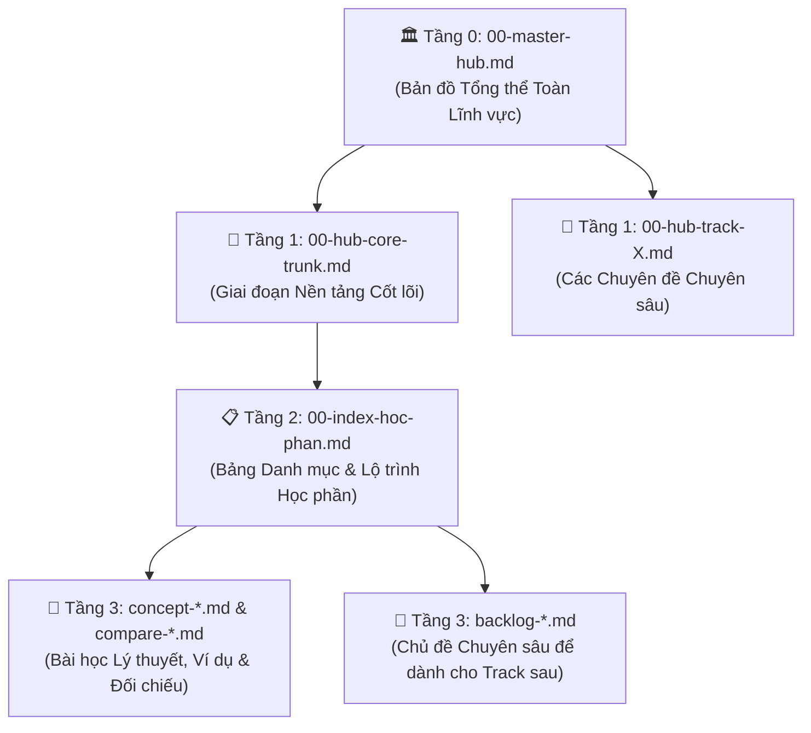

# 🏛️ Bản đồ Tổng thể Kho Tri thức (Master Hub — Tầng 0)

> **Trạng thái:** ⏳ *Vault đang ở trạng thái Clean Slate (Chưa khởi tạo).*
> Hãy gõ **`/init`** trong khung chat với AI Agent để thiết lập lĩnh vực học tập của bạn. Agent sẽ tự động tạo toàn bộ hệ thống Hub Tầng 1 (`00-hub-*`) và Bảng Danh mục Tầng 2 (`00-index-*`) tại đây!

---

## 🧭 Hệ thống Điều hướng 4 Tầng (Sẽ được kích hoạt sau `/init`)

